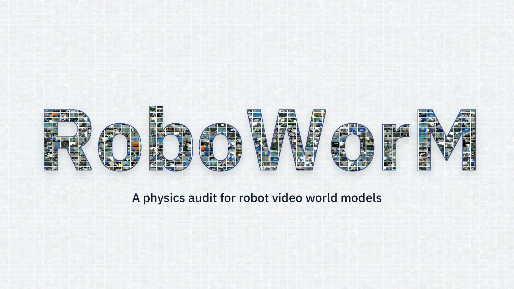
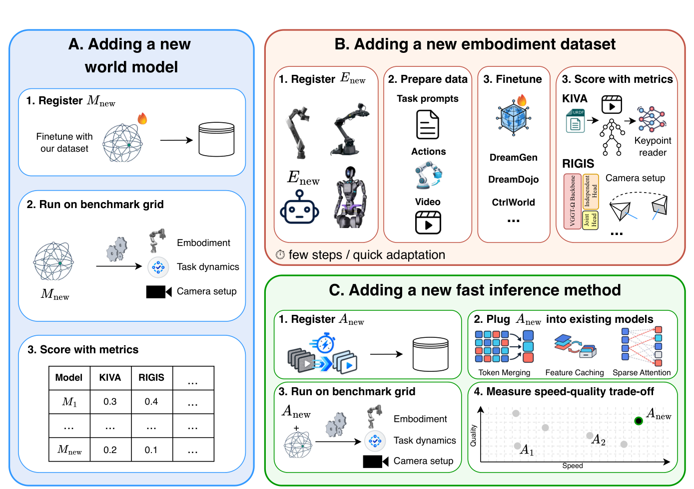

<div align="center">


# RoboWorM: Evaluating Movement Realism, Consistency and Acceleration Affects in Embodied Video World Models

<a href="https://arxiv.org/abs/2610.33807"></a>
<a href="https://roboworm.github.io/roboworm/"></a>
<a href="https://huggingface.co/datasets/doanh25032004/vgp_datasets"></a>
<a href="https://huggingface.co/datasets/doanh25032004/video_gen_physics"></a>
<a href="https://huggingface.co/collections/doanh25032004/roboworm-6acf553906401bef19d99578"></a>
<a href="#citation"></a>

<a href="https://roboworm.github.io/roboworm/#teaser"></a>

</div>

> 🌟 The short version is accepted as a **Spotlight** at
> [*Do Robots Need World Models?*](https://roboworm.github.io/roboworm/) – CoRL 2026 Workshop.

## Latest updates

- 📄 **`2026.10.24`** — Paper released on arXiv:
  [](https://arxiv.org/abs/2610.33807)
- 🌟 **`2026.10`** — The short version is accepted as a **Spotlight** at
  ***Do Robots Need World Models?*** · **CoRL 2026 Workshop** 🎉
- 🤗 **`2026.10`** — Data, rollouts and checkpoints released on Hugging Face:
  [](https://huggingface.co/collections/doanh25032004/roboworm-6acf553906401bef19d99578)
- 🚀 **`2026.10.09`** — Code release **`v1.0.0`**: benchmark, 🧭 KIVA / 📐 RIGIS metrics,
  ⚡ 9 acceleration methods and launchers for all 12 cells.

Code, data pointers and run scripts for **RoboWorM**, a physics audit for robot video
world models and the training-free methods that accelerate them. Rollout videos and
interactive demos are on the **[project page](https://roboworm.github.io/roboworm/)**.

[](https://roboworm.github.io/roboworm/#abstract)

*Benchmark overview: (a) episodes collected from 5 corpora, 3 embodiments, 1–4 views and
two task horizons; (b) the physics audit with KIVA and RIGIS; (c) inference acceleration
across 3 world models and 9 methods, about 29k rollouts.*

- **Data**: 1,605 real episodes, 5 corpora, 3 embodiments (single-arm, bimanual,
  humanoid), 1–4 synced views, Markovian and non-Markovian tasks.
- **World models**: DreamGen, DreamDojo and Ctrl-World, 12 dense cells
  ([checkpoints/CHECKPOINTS.md](checkpoints/CHECKPOINTS.md)).
- **Acceleration**: 9 training-free methods (caching, sparse attention, token reduction),
  about 29k rollouts in total.
- **Metrics**: KIVA and RIGIS (ours), plus Visual Integrity, Text Alignment, FVD and
  PSNR / SSIM / LPIPS against the dense rollout.

[](https://roboworm.github.io/roboworm/#fig6)

*What the audit catches. (a) Hallucinated rollouts that VLM judges rate as good, while
KIVA (single-view) and RIGIS (multi-view) agree with human raters that they are bad.
(b) Dense vs. a well-tuned accelerator (2.1× faster, same score) vs. an over-accelerated
one (2.9× faster, kinematics and geometry break). (c) KIVA degradation grows with rollout
depth, from Markovian to non-Markovian tasks.*

See the [project page](https://roboworm.github.io/roboworm/#fig6) for the rollout videos behind these examples.

## Contents

- [Latest updates](#latest-updates)
- [Proposed metrics: KIVA and RIGIS](#proposed-metrics-kiva-and-rigis)
- [How to use the benchmark](#how-to-use-the-benchmark)
- [1. Installation](#1-installation)
- [2. Data and checkpoints](#2-data-and-checkpoints)
- [3. Training](#3-training)
- [4. Rollouts: dense and accelerated](#4-rollouts-dense-and-accelerated)
- [5. Metrics](#5-metrics)
- [6. Extending RoboWorM](#6-extending-roboworm)
- [Repository layout](#repository-layout)
- [Citation](#citation) · [License](#license) · [Acknowledgements](#acknowledgements)

Full documentation index: [docs/README.md](docs/README.md).

## Proposed metrics: KIVA and RIGIS

Two VLM-free physics metrics that check a rollout against what is already known about the
robot: its kinematic tree and its fixed camera rig.

| metric | what it checks | docs |
|---|---|---|
| **KIVA** (Kinematic Invariant Violation Assessment) | Single view: reads 3-D robot keypoints from the pixels, measures link-rigidity error and joint jerk, calibrated against real footage. | [README](metrics/kiva/README.md) · [setup](docs/metrics/kiva.md) · [#14](https://github.com/ltdoanhwork/RoboWorM/pull/14) |
| **RIGIS** (Robotic Inter-view Geometry & Intrinsic-Extrinsic Stability) | Multi view: VGGT-Ω lifts every view to depth + cameras and scores cross-view geometry (S_geo) and camera-rig stability (S_pose). | [README](metrics/rigis/README.md) · [setup](docs/metrics/rigis.md) · [#13](https://github.com/ltdoanhwork/RoboWorM/pull/13) |

## How to use the benchmark

RoboWorM is used in four ways. None needs training: every fine-tuned checkpoint and
every rollout is released.

**1. Score released rollouts.** Download a cell from
[`video_gen_physics`](https://huggingface.co/datasets/doanh25032004/video_gen_physics)
into `sampling_dataset/`, then score it with `python -m metrics.evaluate`. This also
reproduces the benchmark numbers.
→ [docs/usage.md](docs/usage.md#a-score-released-rollouts)

**2. Evaluate your own world model.** Take the conditioning inputs of each episode from
`sampling_dataset/dense/<embodiment>/input/`, roll out to the full episode length, save
the videos in the same `sampling_dataset/` layout under your model's name, and score them
with the same metrics. Your numbers are then directly comparable with the released ones.
→ [docs/usage.md](docs/usage.md#b-evaluate-your-own-world-model),
[docs/extending/new_world_model.md](docs/extending/new_world_model.md)

**3. Benchmark an acceleration method.** Copy the dense launcher of a cell, add only your
method flags, time it against the dense run on the same GPU, and score its fidelity to
dense plus KIVA / RIGIS.
→ [docs/usage.md](docs/usage.md#c-benchmark-an-acceleration-method),
[docs/extending/new_acceleration_method.md](docs/extending/new_acceleration_method.md)

**4. Use KIVA or RIGIS alone** on any robot video: `kinescore score` for single-view
kinematics, `run_video_metrics` for multi-view geometry.
→ [metrics/kiva/README.md](metrics/kiva/README.md), [metrics/rigis/README.md](metrics/rigis/README.md)

```bash
PY=models/dreamgen/.venv/bin/python
CELL=single_arm/output/singleview/dreamgen/makovian
$PY -m metrics.evaluate --pred-root sampling_dataset/dense/$CELL \
    --metrics visual_integrity text_alignment --ref-template '' --out results/metrics/dense_sa
$PY -m metrics.evaluate --pred-root sampling_dataset/pisa/$CELL --ref-root sampling_dataset/dense/$CELL \
    --ref-template '{name}' --metrics fidelity --out results/metrics/pisa_sa
```

## 1. Installation

```bash
git clone --recursive https://github.com/ltdoanhwork/RoboWorM.git
# existing clone: git submodule update --init --recursive
```

Each model and metric has its own isolated environment (never mix them; launchers activate
the right one). Exact install commands, versions and a verification snippet:
[docs/setup/README.md](docs/setup/README.md).

| env | used for |
|---|---|
| `models/dreamgen/.venv` (py3.12, torch 2.6 cu124) | DreamGen, every method except SVG2, `metrics.evaluate` |
| `models/dreamgen/.venv_svg` (flashinfer 0.3.1) | DreamGen SVG2 |
| `models/DreamDojo/.venv` (py3.10, torch 2.7 cu128) | DreamDojo, all methods |
| `models/Ctrl-World/.venv` (py3.10, torch 2.7.1 cu126) | Ctrl-World, all methods |
| `metrics/rigis/.venv` (py3.13) | RIGIS |
| KIVA env (py3.10, `pip install -e "metrics/kiva[dino,video,bench]"`) | KIVA |

Also required: `ffmpeg` / `ffprobe` on `PATH`, and `export HF_HUB_DISABLE_XET=1` for
Hugging Face downloads on parallel filesystems.

## 2. Data and checkpoints

[](https://roboworm.github.io/roboworm/#benchmark)

Every dataset, rollout and checkpoint repo is grouped in the **[RoboWorM Hugging Face collection](https://huggingface.co/collections/doanh25032004/roboworm-6acf553906401bef19d99578)**.

| download | HF repo | put it in |
|---|---|---|
| source / training data (LeRobot) | [`vgp_datasets`](https://huggingface.co/datasets/doanh25032004/vgp_datasets) | `datasets/` |
| benchmark rollouts (dense + 9 methods) | [`video_gen_physics`](https://huggingface.co/datasets/doanh25032004/video_gen_physics) | `sampling_dataset/` |
| base, metric and fine-tuned weights | `vgp_checkpoints_*`, [`vgp_exp_logs`](https://huggingface.co/doanh25032004/vgp_exp_logs) | `checkpoints/` |

All repos are in the HF collection [RoboWorM](https://huggingface.co/collections/doanh25032004/roboworm-6acf553906401bef19d99578).

```bash
export HF_HUB_DISABLE_XET=1
hf download doanh25032004/vgp_datasets      --repo-type dataset --local-dir datasets --include "humanoid/singleview/*"
hf download doanh25032004/video_gen_physics --repo-type dataset --local-dir sampling_dataset --include "dense/*"
```

All fine-tuned DreamGen and DreamDojo checkpoints are only on HF (`vgp_exp_logs`). Download a
cell before you run its launcher. For example, DreamGen humanoid SV writes to
`checkpoints/finetuned/dreamgen/posttraining/singleview/humanoid_singleview_16fps/`:

```bash
mkdir -p exp_logs checkpoints/finetuned/dreamgen checkpoints/finetuned/dreamdojo
[ -e exp_logs/dreamgen_logs ]  || ln -s ../checkpoints/finetuned/dreamgen  exp_logs/dreamgen_logs
[ -e exp_logs/dreamdojo_logs ] || ln -s ../checkpoints/finetuned/dreamdojo exp_logs/dreamdojo_logs
hf download doanh25032004/vgp_exp_logs --local-dir exp_logs \
  --include 'dreamgen_logs/posttraining/singleview/humanoid_singleview_16fps/*'
```

- All download commands, the expected tree and a sanity check: [docs/datasets/download.md](docs/datasets/download.md)
- Corpora, splits and layout: [docs/datasets/README.md](docs/datasets/README.md), [docs/datasets/sampling_dataset.md](docs/datasets/sampling_dataset.md)
- Checkpoint of every cell, the launcher path it expects and its `hf download` command: [checkpoints/CHECKPOINTS.md](checkpoints/CHECKPOINTS.md)

## 3. Training

Optional: all fine-tuned checkpoints are released. Three cells use released base weights;
the other 9 were post-trained, each on one prepared input built from `datasets/`.
Checkpoint → prepare script → training input → launcher: [docs/training/README.md](docs/training/README.md).

```bash
NPROC=4 bash finetuning/dreamgen/train_bimanual_16fps.sh                      # DreamGen 2B
NPROC=2 bash finetuning/dreamdojo/launch.sh dreamdojo_2b_480_640_single_arm_sv  # DreamDojo 2B
NPROC=4 bash scripts/train/run_humanoid_multiview_ctrlworld_train_4view_grid.sh # Ctrl-World
```

## 4. Rollouts: dense and accelerated

Launchers live in `scripts/run/{dreamgen,dreamdojo,ctrlworld}/`, named
`run_<embodiment>_<view>_<model>[_4view_grid]_<method>.sh`. They are resumable, discover
episodes automatically and write to `sampling_dataset/<method>/...`. Each accelerated
launcher equals the dense launcher of its cell plus the method flags.

```bash
bash scripts/run/dreamgen/run_humanoid_multiview_dreamgen_full.sh              # DreamGen dense
bash scripts/run/dreamgen/run_humanoid_multiview_dreamgen_dicache.sh           # DreamGen + DiCache
bash scripts/run/dreamdojo/run_humanoid_singleview_dreamdojo_all_methods.sh    # DreamDojo, all 9 methods
bash scripts/run/ctrlworld/run_bimanual_multiview_ctrlworld_4view_grid.sh      # Ctrl-World dense
```

- 12 dense launchers and knobs: [docs/inference/README.md](docs/inference/README.md)
- 9 methods, (cell × method) configs, speedup protocol: [docs/acceleration/README.md](docs/acceleration/README.md)
- How each method hooks into each backbone: [methods/README.md](methods/README.md)

[](https://roboworm.github.io/roboworm/#acceleration)

*Speedup over dense vs physical audit for every method on the bimanual cells.*

## 5. Metrics

One CLI for all metrics: `python -m metrics.evaluate --metrics <name> ...`.

| metric | registry name | reference |
|---|---|---|
| KIVA, RIGIS (ours) | `kiva`, `rigis` | none (physics audit) |
| Visual Integrity (CLIP-IQA+) | `visual_integrity` | none |
| Text Alignment (CLIPScore) | `text_alignment` | prompt |
| FVD (I3D) | `fvd` | shared real pool |
| PSNR / SSIM / LPIPS | `fidelity` | dense rollout of the same episode (never GT) |

- Registry, options and citations: [metrics/README.md](metrics/README.md)
- Protocol and full-benchmark sweep commands: [docs/metrics/README.md](docs/metrics/README.md)

## 6. Extending RoboWorM

Add a world model (new row), an embodiment / dataset (new column), an acceleration method or
a metric. Metrics are stored per clip, so a new entrant is comparable with every existing
number without re-scoring.

[](docs/extending/README.md)

| add | guide |
|---|---|
| a world model | [new_world_model.md](docs/extending/new_world_model.md) |
| an embodiment / dataset | [new_embodiment_dataset.md](docs/extending/new_embodiment_dataset.md) |
| an acceleration method | [new_acceleration_method.md](docs/extending/new_acceleration_method.md) |
| a metric | [new_metric.md](docs/extending/new_metric.md) |

## Repository layout

```
datasets/          source / training data (LeRobot) + DreamGen corpora      -> HF vgp_datasets
sampling_dataset/  rollouts {method}/{embodiment}/{input,output}/...         -> HF video_gen_physics
checkpoints/       base/, finetuned/, metrics/
models/            dreamgen/ (Cosmos-Predict2), DreamDojo/, Ctrl-World/   (own .venv each)
methods/           cache_strategy/, sparse_attention/, prunning/
finetuning/        training launchers + data prep per model
scripts/           prepare/ infer/ run/ train/ metrics/ tables/ tools/       (scripts/README.md)
metrics/           evaluate.py, registry.py, kiva/, rigis/, fvd/, ...
docs/              setup, datasets, training, inference, acceleration, metrics, extending
```

## Citation

```bibtex
@article{lethien2026roboworm,
  title   = {RoboWorM: Evaluating Movement Realism, Consistency and Acceleration Affects in Embodied Video World Models},
  author  = {Le Thien, Doanh and Nguyen, Viet-Thanh and Pham, Tri Quang and Pham, Nhi and Wewer, Christopher and
             Nguyen, Minh-Loi and Tran, Hoang H. and Le, Tho and Luu, Tung M. and Le, Dung D. and Duong, Vu N. and
             Fischer, Jonas and Le, Ngan and Le, An Thai and Sonntag, Daniel and Lee, Gim Hee and Zou, James and
             Niepert, Mathias and Peters, Jan and Nguyen, Duy M. H. and Vien, Ngo Anh},
  journal = {arXiv preprint arXiv:2610.33807},
  year    = {2026},
  url     = {https://arxiv.org/abs/2610.33807}
}
```

## License

RoboWorM's own code is released under the [Apache License 2.0](LICENSE) (see also
[NOTICE](NOTICE)). Third-party code under `models/`, `methods/` and `metrics/` keeps its
own license, listed below and in [docs/THIRD_PARTY.md](docs/THIRD_PARTY.md). VGGT-Omega
(FAIR Noncommercial), DINOv3 (DINOv3 License) and pyiqa (PolyForm Noncommercial) are
non-commercial only, so the full pipeline is for non-commercial research. FasterCache and
SiTo declare no upstream license. Datasets and rollouts on Hugging Face follow the
licenses of their source corpora.

## Acknowledgements

RoboWorM builds on the code of many projects. Each project keeps its own license, and
its LICENSE file stays in the vendored directory. Paths, commits, our changes and the
license-file locations are listed in [docs/THIRD_PARTY.md](docs/THIRD_PARTY.md).
Dataset licenses follow the source corpora: DROID, RoboChallenge, AIST Bimanual,
RoboCOIN and GR00T Teleop GR1.

| role | project | license | in this repo |
|---|---|---|---|
| world model | [Cosmos-Predict2](https://github.com/nvidia-cosmos/cosmos-predict2) / [GR00T Dreams](https://github.com/NVIDIA/GR00T-Dreams) | Apache-2.0 | `models/dreamgen/` |
| world model | [DreamDojo](https://github.com/NVIDIA/DreamDojo) | Apache-2.0 | `models/DreamDojo/` |
| world model | [Ctrl-World](https://github.com/Robert-gyj/Ctrl-World) (+ [diffusers](https://github.com/huggingface/diffusers) SVD pipeline) | MIT (Apache-2.0) | `models/Ctrl-World/` |
| policy | [openpi](https://github.com/Physical-Intelligence/openpi) | Apache-2.0 | `models/Ctrl-World/openpi` (submodule) |
| caching | [FasterCache](https://github.com/Vchitect/FasterCache) | none declared | `methods/cache_strategy/FasterCache/` |
| caching | [DiCache](https://github.com/Bujiazi/DiCache), [WorldCache](https://github.com/umair1221/WorldCache) | re-implemented | `methods/cache_strategy/{DiCache,WorldCache}/` |
| sparse attention | [Sparse VideoGen 1/2](https://github.com/svg-project/Sparse-VideoGen) (+ CUTLASS, FlashInfer, pybind11) | Apache-2.0 | `methods/sparse_attention/Sparse-VideoGen/` |
| sparse attention | [Radial Attention](https://github.com/mit-han-lab/radial-attention) | Apache-2.0 | `methods/sparse_attention/radial-attention/` |
| sparse attention | [PISA](https://github.com/xie-lab-ml/piecewise-sparse-attention) | MIT | `methods/sparse_attention/piecewise-sparse-attention/` |
| token reduction | [SiTo](https://github.com/EvelynZhang-epiclab/SiTo) (on [ToMeSD](https://github.com/dbolya/tomesd), MIT) | none declared | `methods/prunning/SiTo/` |
| token reduction | [Importance-Based Token Merging](https://github.com/cvlab-stonybrook/importance-token-merge) | MIT | `methods/prunning/importance-token-merge/` |
| RIGIS | [VGGT-Omega](https://github.com/facebookresearch/vggt-omega) | FAIR Noncommercial Research | `metrics/rigis/vggt_omega/` |
| KIVA | [DINOv3](https://github.com/facebookresearch/dinov3), [pytorch-kinematics](https://github.com/UM-ARM-Lab/pytorch_kinematics), [robot_descriptions](https://github.com/robot-descriptions/robot_descriptions.py) | DINOv3 License, MIT, Apache-2.0 | pip / HF weights |
| motion metrics | [WorldScore](https://github.com/haoyi-duan/WorldScore) with [SEA-RAFT](https://github.com/princeton-vl/SEA-RAFT), [VFIMamba](https://github.com/MCG-NJU/VFIMamba), [GroundingDINO](https://github.com/IDEA-Research/GroundingDINO), [SAM 2](https://github.com/facebookresearch/sam2) | MIT, BSD-3, Apache-2.0 | `metrics/WorldScore` (submodule) |
| Visual Integrity | CLIP-IQA+ via [pyiqa](https://github.com/chaofengc/IQA-PyTorch) | PolyForm Noncommercial 1.0.0 | pip |
| Text Alignment | CLIPScore via [torchmetrics](https://github.com/Lightning-AI/torchmetrics) + [CLIP](https://github.com/openai/CLIP) | Apache-2.0, MIT | pip |
| fidelity, FVD | [piq](https://github.com/photosynthesis-team/piq) ([LPIPS](https://github.com/richzhang/PerceptualSimilarity)), [I3D](https://github.com/google-deepmind/kinetics-i3d) via [StyleGAN-V](https://github.com/universome/stylegan-v) export | Apache-2.0, BSD-2 | pip / `checkpoints/metrics/fvd/` |

Motion Amplitude (RBench) and FVD are re-implemented from their papers.
